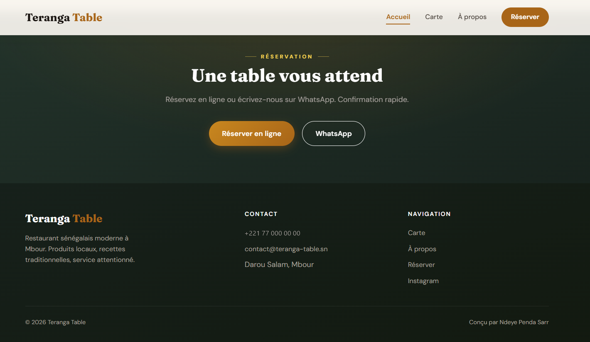
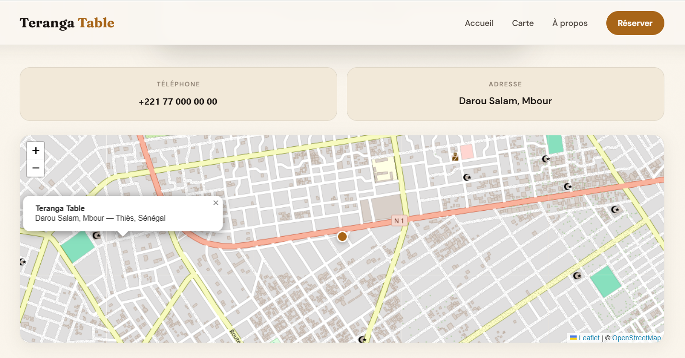
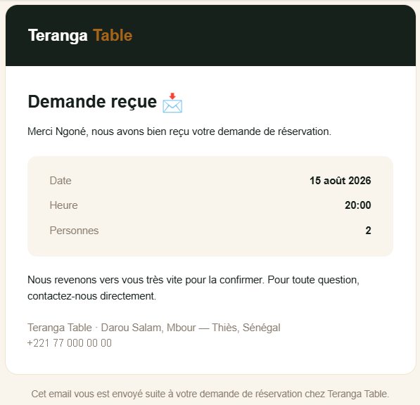
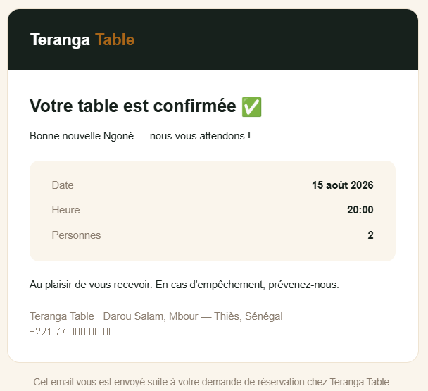
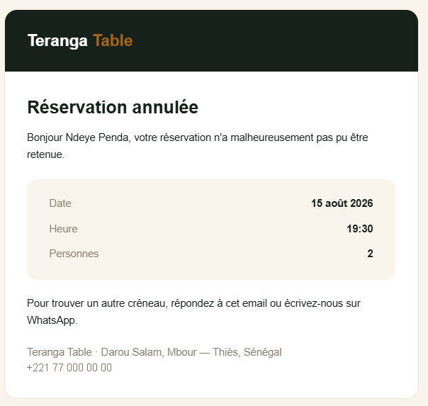

# 🍽️ Teranga Table — Full-stack restaurant booking app

🇫🇷 [Version française](README.fr.md)

> A full-stack web app that handles table bookings for a Senegalese restaurant, built with Next.js, React, TypeScript, PostgreSQL and a secured REST API.

**Frontend → API → server-side validation → PostgreSQL → admin dashboard → email notifications**

🔗 **Live demo:** https://teranga-table.vercel.app/

> **About this project:** a personal portfolio project. The restaurant is fictional. The visual design is adapted from a static HTML/CSS template; the full-stack layer (Next.js App Router, REST API, validation, database, authentication, admin dashboard, emails, tests and CI) was built for this project.

The user interface is in French (the target audience is in Senegal); the code comments are in French as well.

## 🖼️ Screenshots

### Public website

| Home | Signature dishes |
| :---: | :---: |
|  |  |

| Menu — Dinner | Menu — Juices & drinks |
| :---: | :---: |
|  |  |

| Our story | Booking call-to-action & footer |
| :---: | :---: |
|  |  |

### Booking & location

| Booking form | Location map |
| :---: | :---: |
|  |  |

The location map (Leaflet / OpenStreetMap, pulsing gold marker) points to the
address configured in `content/site.ts`.

### Admin dashboard

| Login | Bookings table |
| :---: | :---: |
|  |  |

### 📧 Email notifications (Brevo)

Customers receive an automatic email at each step of their booking, using a
branded template (date, time, party size).

| In the inbox | Acknowledgement (on submission) |
| :---: | :---: |
|  |  |

| Confirmation (by the admin) | Cancellation (by the admin) |
| :---: | :---: |
|  |  |

## ✨ Features

- **Public website**: editorial home page, menu filterable by category, about
  page, booking page, Leaflet location map.
- **Full-stack booking**: form → `POST /api/reservations` with **server-side
  validation (zod)** → stored in **PostgreSQL** (Drizzle ORM).
- **Admin dashboard** (`/admin`, protected): list of bookings, filter by
  status, one-click confirm / cancel (`PATCH /api/reservations/:id`).
- **Transactional emails (Brevo)**: the customer gets an acknowledgement when
  they submit a request, then a second email when the admin confirms or
  cancels. A failed send never fails the booking or the admin action; it is
  only logged.
- **Authentication**: password login → **signed session cookie (JWT via
  jose, httpOnly)**, `middleware` protecting `/admin`, session re-checked in
  every admin API route, constant-time password comparison.
- **Abuse protection**:
  - user input is **HTML-escaped** before it goes into email templates
    (prevents injecting links or markup into emails sent from the
    restaurant's address);
  - **rate limiting per IP** on booking requests (5 / 10 min) and on admin
    login (5 / 15 min), answering `429` with `Retry-After`;
  - a **honeypot field** silently drops bot submissions;
  - the post-login redirect only accepts internal paths (no open redirect).
- **Animations**: staggered scroll reveal, hero entrance, animated cards when
  the filter changes, micro-interactions — all disabled under
  `prefers-reduced-motion`.

## 🧱 Stack & architecture

| Layer               | Choice                                                       |
| ------------------- | ------------------------------------------------------------ |
| Framework           | Next.js 16 (App Router, Route Handlers, middleware)          |
| UI                  | React 19                                                     |
| Language            | TypeScript (strict)                                          |
| Styling             | Tailwind v4 + custom design system (`app/globals.css`)       |
| Database            | PostgreSQL via **Drizzle ORM** + **Neon** serverless driver  |
| Validation          | **zod** (shared by client and server)                        |
| Auth                | **jose** (signed JWT in an httpOnly cookie)                  |
| Transactional email | **Brevo** (REST API, no npm dependency)                      |
| Map                 | **Leaflet** + OpenStreetMap (no API key)                     |
| Tests               | Vitest                                                       |
| CI                  | GitHub Actions                                               |

```
app/            public pages, /admin, and /api (Route Handlers)
components/     Header, Footer, MenuGrid, ReservationForm, AdminTable, RestaurantMap…
content/        site.ts + menu.ts (typed content, kept apart from the code)
db/             Drizzle schema + client (lazy initialisation)
lib/            validation (zod), auth (jose), email (Brevo), rate limiting, HTML escaping
drizzle/        generated SQL migrations
```

### API

| Method & route                 | Access | Description                                   |
| ------------------------------ | ------ | --------------------------------------------- |
| `POST /api/reservations`       | Public | Create a booking request (validated, rate-limited) |
| `GET /api/reservations`        | Admin  | List bookings, most recent first              |
| `PATCH /api/reservations/:id`  | Admin  | Change status (`confirmee` / `annulee`) and email the customer |
| `POST /api/admin/login`        | Public | Log in, sets the session cookie (rate-limited) |
| `POST /api/admin/logout`       | Admin  | Clear the session cookie                      |

## 🚀 Run locally

### 1. Install

```bash
npm install
```

### 2. Database (Neon — free tier)

1. Create a project on [neon.tech](https://neon.tech).
2. Copy the **pooled** connection string.
3. Copy `.env.example` to `.env` and fill in the variables:

```bash
cp .env.example .env
```

```dotenv
DATABASE_URL="postgresql://…@…neon.tech/…?sslmode=require"
ADMIN_PASSWORD="your-admin-password"
AUTH_SECRET="a-long-random-string"   # openssl rand -base64 32
```

### 3. Transactional emails (Brevo — free tier, 300 emails/day)

1. Create an account on [brevo.com](https://brevo.com).
2. Verify a sender address: **Settings** → **Senders, Domains & IPs** →
   **Senders** → add and verify your address.
3. Create an API key: **Settings** → **SMTP & API** → **API Keys** →
   **Generate a new API key**.
4. Add these variables to your `.env`:

```dotenv
BREVO_API_KEY="xkeysib-your-key"
EMAIL_FROM="verified-address@example.com"
EMAIL_FROM_NAME="Teranga Table"
```

> Without these variables the site still works — emails are simply skipped
> (a warning is logged).

### 4. Create the tables

```bash
npm run db:migrate
```

### 5. Start

```bash
npm run dev            # http://localhost:3000
```

The admin dashboard is at **`/admin`** (password = `ADMIN_PASSWORD`).

## 🧪 Commands

```bash
npm test             # unit tests (Vitest)
npm run lint         # ESLint
npx tsc --noEmit     # type-check
npm run build        # production build
npm run db:generate  # generate a migration after a schema change
npm run db:migrate   # apply migrations
```

## ✅ Quality & tests

- **Strict TypeScript**, **ESLint** and production build with zero errors.
- **Vitest tests**: booking validation (Senegalese phone numbers, past dates,
  time slots, limits), HTML escaping, open-redirect guard, rate limiter, and
  menu data integrity (fields, unique keys, local images exist).
- **GitHub Actions CI**: lint + type-check + tests + build on every push and
  pull request.
- **Accessibility**: skip link, visible focus, keyboard navigation, ARIA
  attributes, `prefers-reduced-motion`.

## ⚠️ Known limitations

- The rate limiter is in memory: on a serverless platform each instance keeps
  its own counters, so it is a best-effort protection. A shared store such as
  Upstash Redis can be plugged in behind the same `limiter()` function.
- The admin area uses a single shared password (no user accounts or roles).
- No pagination on the admin bookings list yet.

## 🌍 Deploy on Vercel

1. Import the repository on [vercel.com](https://vercel.com).
2. Add the **environment variables** (`DATABASE_URL`, `ADMIN_PASSWORD`,
   `AUTH_SECRET`, `BREVO_API_KEY`, `EMAIL_FROM`, `EMAIL_FROM_NAME`) for the
   Production, Preview and Development environments.
3. Apply the migrations to your Neon database (`npm run db:migrate` locally,
   pointing to the same database).
4. Deploy.

## 📄 License

[MIT](LICENSE)

---

Designed and built by **Ndeye Penda Sarr** — 2026.
